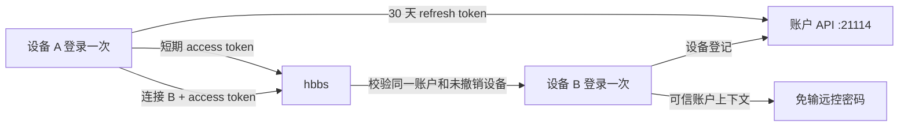

# RustChair 个人账户服务

RustChair 的个人账户能力基于官方 `rustdesk-server`，服务端源码按本项目约定放在被忽略的 `.feeds/` 目录中：

```text
.feeds/rustdesk-server
├── hbbs                 # ID、会合、账户 API、同账户连接授权
├── hbbr                 # 中继服务
└── db_v2.sqlite3        # 设备和会话持久化数据
```

当前开发基线：

- `rustdesk-server`: `d83a0b12f57e0bde20d76eb5e558f6e4bd1470a9`
- `libs/hbb_common`: `e9aed585ca4b3d08778d698e90edd3cea549a9ef`

## 体验与安全边界



- 账户密码只在登录时使用，服务端保存 bcrypt 哈希。
- access token 有效期 15 分钟；客户端在启动和连接前自动刷新。
- refresh token 有效期 30 天，每次使用后轮换；数据库只保存 SHA-256 哈希。
- 客户端本地的 access/refresh token 使用现有机器绑定配置加密后保存。
- 断网或账户 API 临时不可达时保留本地登录展示；同账户授权不可验证时自动退回原有远控密码流程。
- 撤销设备会在一个 SQLite 事务中同时撤销该设备的全部会话。被撤销设备可用账户密码重新登录。
- 同账户免密只适用于已经分别登录过同一账户、且未被撤销的设备。

## 初始化 feed

```bash
mkdir -p .feeds
git clone https://github.com/rust-chair/RustChair-server.git .feeds/rustdesk-server
git -C .feeds/rustdesk-server checkout d83a0b12f57e0bde20d76eb5e558f6e4bd1470a9
git -C .feeds/rustdesk-server submodule update --init --recursive
```

账户功能的服务端源码维护在 `rust-chair/RustChair-server`，本地仍按开发约定放在 ignored feed 工作区中；不要用重新 clone 覆盖已有的本地运行数据和配置。

## 配置

在 `.feeds/rustdesk-server/.env` 中配置单个个人账户：

```dotenv
RUSTCHAIR_USERNAME=your-name
RUSTCHAIR_PASSWORD=replace-with-a-long-password
RUSTCHAIR_JWT_SECRET=replace-with-at-least-32-random-characters
```

JWT secret 可用下面的命令生成：

```bash
openssl rand -hex 32
```

约束：密码至少 8 个字符，JWT secret 至少 32 个字符。三项全部不配置时，账户 API 关闭，服务端保持原始 OSS 行为；只配置一部分会拒绝启动。

## 本地启动

分别启动 ID/账户服务和中继服务：

```bash
cd .feeds/rustdesk-server
cargo run --release -- -p 21116 -r 127.0.0.1:21117
```

```bash
cd .feeds/rustdesk-server
cargo run --release --bin hbbr -- -p 21117
```

账户 API 随 `hbbs` 启动，端口固定为 ID 端口减 2；使用默认 ID 端口时即 `21114`。`db_v2.sqlite3` 位于服务进程工作目录，生产部署必须把该文件所在目录挂载到持久卷并定期备份。

健康检查：

```bash
curl http://127.0.0.1:21114/api/health
```

## 客户端配置

在“ID/Relay Server”中设置：

| 字段 | 本地示例 | 公网示例 |
|---|---|---|
| ID Server | `127.0.0.1:21116` | `remote.example.com:21116` |
| Relay Server | `127.0.0.1:21117` | `remote.example.com:21117` |
| API Server | `http://127.0.0.1:21114` | `https://remote.example.com` |
| Key | hbbs 公钥 | hbbs 公钥 |

未显式填写 API Server 时，客户端会从 ID Server 自动推导 `ID 端口 - 2`。公网部署必须显式配置 HTTPS API 地址。

## 公网部署要求

账户登录会提交用户名和密码，不能把明文 HTTP 的 `21114` 暴露到公网。生产环境应：

1. 用 Nginx、Caddy 或 Cloudflare Tunnel 给账户 API 提供 HTTPS。
2. 仅由反向代理访问 `21114`，防火墙不对公网直接开放该端口。
3. 对外开放 RustDesk 所需的 ID/中继端口，并为 hbbs/hbbr 使用同一套持久化密钥。
4. 持久化并备份 `db_v2.sqlite3`，同时妥善保存 `RUSTCHAIR_JWT_SECRET`；更换 secret 会使现有 access token 立即失效。

## 账户 API

| 方法 | 路径 | 用途 |
|---|---|---|
| `GET` | `/api/health` | 健康检查 |
| `GET` | `/api/login-options` | 客户端登录能力探测 |
| `POST` | `/api/login` | 密码登录并登记设备 |
| `POST` | `/api/token/refresh` | 轮换 refresh token |
| `POST` | `/api/currentUser` | 恢复并校验登录态 |
| `POST` | `/api/logout` | 撤销当前会话 |
| `GET` | `/api/devices` | 设备列表和在线状态 |
| `PUT` | `/api/devices/:id` | 重命名设备 |
| `DELETE` | `/api/devices/:id` | 撤销设备及其会话 |

## 验收清单

1. 设备 A 登录后重启客户端，仍显示已登录且无需再次输入账户密码。
2. 设备 B 登录同一账户后，A/B 的“我的设备”都能看到两台设备及在线状态。
3. A 从设备列表连接 B，不输入远控密码即可建立连接。
4. 关闭账户 API 后重启 A，仍显示离线登录态，原有远控密码连接仍可使用。
5. A 撤销 B 后，B 的 refresh token 和同账户免密授权立即失效。
6. B 使用账户密码重新登录后，重新出现在设备列表并恢复同账户授权。
